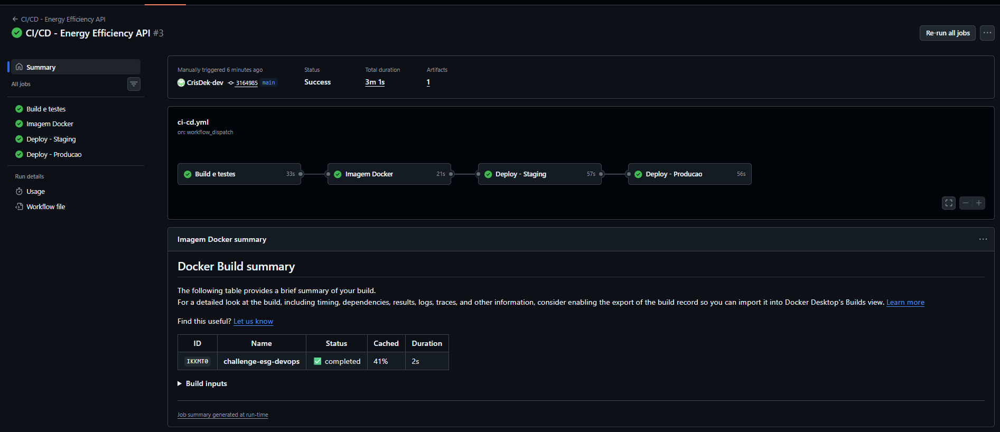
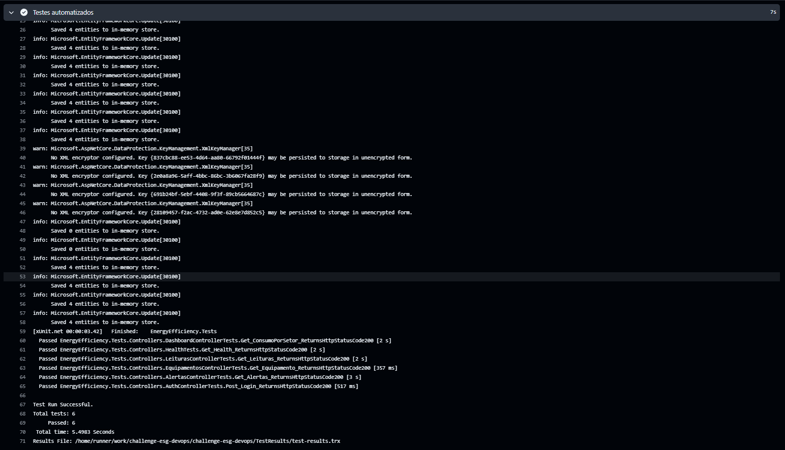
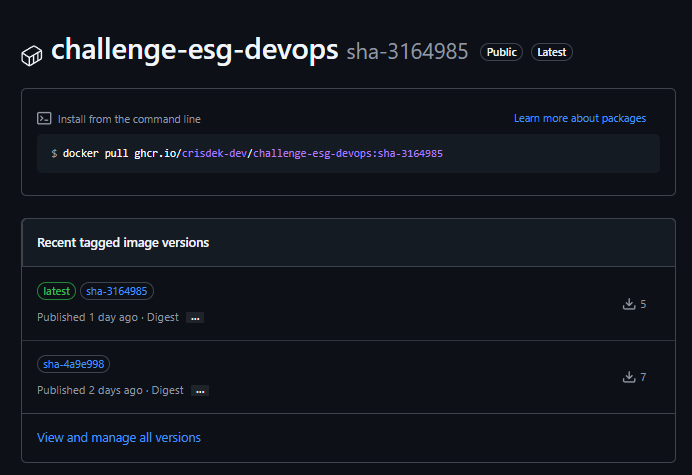
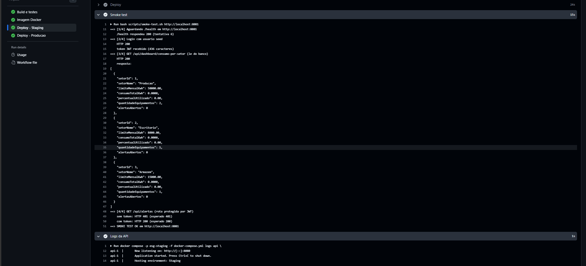
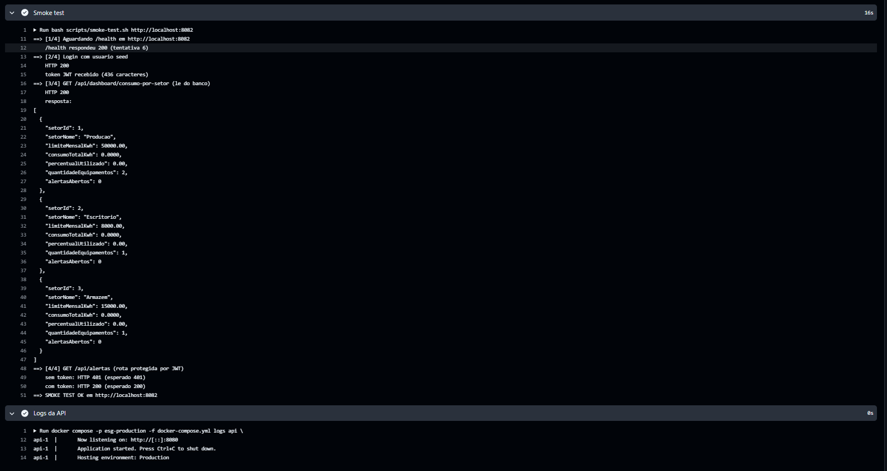
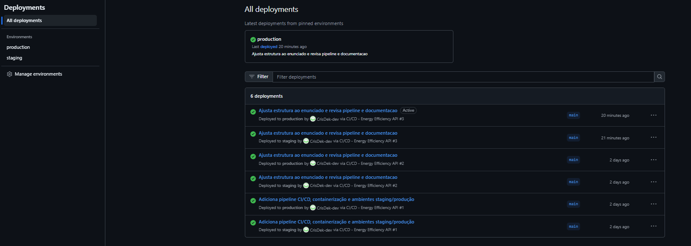

# Projeto - Cidades ESG Inteligentes

**Energy Efficiency API** - monitoramento de consumo de energia (ESG - Eficiência Energética e Sustentabilidade).

**Aluno:** Cristofer Ridek Ribeiro Yanachi - **RM:** 561914 - **Turma:** 2TDSOB

**Repositório:** https://github.com/CrisDek-dev/challenge-esg-devops

**Documentação técnica (PDF):** [docs/documentacao.pdf](docs/documentacao.pdf)

API REST em ASP.NET Core 8 que recebe leituras de consumo dos equipamentos de cada setor
(produção, escritório, armazém), gera alertas quando o setor passa do limite mensal de kWh,
permite ligar/desligar equipamentos (somente ADMIN) e entrega um relatório de consumo por setor.

Nesta entrega o projeto do challenge .NET foi adaptado para um fluxo DevOps completo:
pipeline de CI/CD no GitHub Actions, imagem Docker publicada no GitHub Container Registry
e deploy automatizado em dois ambientes (staging e produção).

---

## Testes automatizados (BDD)

Na atividade de **Testes Automatizados** o projeto ganhou a pasta
[`testes-automatizados/`](testes-automatizados/README.md): testes BDD em **Gherkin (português)**
com **Java + Cucumber + Rest Assured**, cobrindo **todos os endpoints** da API com validação de
status code, do corpo JSON e de **contrato (JSON Schema)**.

- 6 funcionalidades, 26 cenários (positivos e negativos), 9 contratos JSON Schema;
- executam localmente (`executar-testes-bdd.bat` ou `mvnw clean test`), em Docker
  (`docker-compose.testes.yml`) e no pipeline (job **Testes BDD (API)**, que bloqueia a imagem e
  os deploys se algum cenário falhar);
- documentação dos cenários e evidências: [docs/testes-automatizados.pdf](docs/testes-automatizados.pdf).

Execução rápida, tudo em containers (na raiz, com o `.env` criado):

```
docker compose -f docker-compose.yml -f docker-compose.testes.yml up --build --exit-code-from testes
```

Instruções completas no [README dos testes](testes-automatizados/README.md).

---

## Como executar localmente com Docker

Pré-requisito: Docker Desktop (ou Docker Engine + Docker Compose v2).

1. Clonar o repositório:
   ```
   git clone https://github.com/CrisDek-dev/challenge-esg-devops.git
   cd challenge-esg-devops
   ```
2. Criar o arquivo `.env` a partir do exemplo (se quiser trocar as senhas, troque antes do primeiro `up`):
   ```
   copy .env.example .env      # Prompt de Comando (cmd) do Windows
   cp .env.example .env        # PowerShell, Git Bash, Linux/Mac
   ```
3. Subir a aplicação + banco:
   ```
   docker compose up -d --build
   ```
4. Acessar o Swagger em http://localhost:8080 (health check em http://localhost:8080/health).

Usuário criado automaticamente (seed): `admin@energia.com` / `admin@123`, com papel **ADMIN**.
No Swagger, fazer login em `/api/auth/login`, copiar o token e colar em **Authorize**.

Para derrubar tudo (incluindo o volume do banco):
```
docker compose down -v
```

Se trocar a `SA_PASSWORD` depois de já ter subido uma vez, rode `docker compose down -v` antes do
próximo `up`, porque o banco guarda a senha antiga no volume. Se o `sqlserver` ficar *unhealthy*,
veja o motivo com `docker compose logs sqlserver`.

O `docker-compose.override.yml` é carregado automaticamente nesse modo local e expõe o banco na
porta **14333** do host (no SSMS: `localhost,14333`). Não usei a 1433 para não conflitar com um
SQL Server já instalado na máquina.

**Rodar a mesma stack como staging (igual o pipeline faz):**
```
docker compose -p esg-staging -f docker-compose.yml --env-file .env --env-file env/staging.env up -d
```
A API de staging fica em http://localhost:8081. Para derrubar, use o mesmo comando trocando
`up -d` por `down -v`. Para produção, troque `staging` por `production` (porta 8082).

### Executar sem Docker (opcional)

Precisa do .NET 8 SDK e de um SQL Server local (a connection string padrão do `appsettings.json`
usa `localhost` com autenticação do Windows).

- `executar-api.bat`: restaura, compila, sobe a API e abre o Swagger em http://localhost:5000
- `executar-testes.bat`: roda os testes (o mesmo que `dotnet test` na raiz)

A pasta `insomnia/` tem uma collection com todos os endpoints. Ela vem configurada para
http://localhost:5000; ao usar Docker, troque a variável `base_url` para http://localhost:8080.

### Endpoints

| Método | Rota                                | Acesso  | Função |
|--------|-------------------------------------|---------|--------|
| GET    | /health                             | público | Health check |
| POST   | /api/auth/login                     | público | Login, retorna o token JWT |
| GET    | /api/leituras                       | público | Lista leituras (paginado, com filtros) |
| POST   | /api/leituras                       | JWT     | Registra leitura e gera alerta se passar do limite |
| GET    | /api/alertas                        | JWT     | Lista alertas (paginado) |
| PATCH  | /api/alertas/{id}/resolver          | ADMIN   | Marca alerta como resolvido |
| GET    | /api/dashboard/consumo-por-setor    | público | Relatório de consumo por setor |
| GET    | /api/equipamentos/{id}              | público | Detalhes do equipamento |
| POST   | /api/equipamentos/{id}/desligar     | ADMIN   | Desliga o equipamento (simula IoT) |
| POST   | /api/equipamentos/{id}/ligar        | ADMIN   | Liga o equipamento |

Teste rápido no Swagger, depois do login: `POST /api/leituras` com
`{ "equipamentoId": 1, "dataHora": "2026-06-18T10:00:00Z", "consumoKwh": 60000 }`.
O equipamento 1 é do setor Produção (limite 50000 kWh), então a resposta vem com
`gerouAlerta: true` e o alerta aparece em `GET /api/alertas`.

---

## Pipeline CI/CD

**Ferramenta:** GitHub Actions, arquivo `.github/workflows/ci-cd.yml`.

O pipeline roda a cada `push` na branch `main` e também pode ser disparado manualmente
(aba Actions > Run workflow). Em pull requests roda só a parte de build e testes.

| # | Job | O que faz |
|---|-----|-----------|
| 1 | **Build e testes** | Restaura as dependências, compila em Release e roda os 6 testes xUnit. O resultado (.trx) fica salvo como artefato `test-results` da execução. |
| 2 | **Testes BDD (API)** | Sobe API + SQL Server com `docker compose`, executa os 26 cenários Cucumber (`./mvnw clean test`) e de novo pelo container de testes; publica o resumo e o relatório `relatorio-testes-bdd`. |
| 3 | **Imagem Docker** | Só roda se os jobs 1 e 2 passaram. Builda a imagem com o `Dockerfile` e publica no GitHub Container Registry com duas tags: `sha-<commit>` e `latest`. |
| 4 | **Deploy - Staging** | Baixa a imagem, sobe API + SQL Server com `docker compose` usando `env/staging.env` (porta 8081) e roda o smoke test. |
| 5 | **Deploy - Producao** | Só roda se staging passou. Mesma imagem, configuração de `env/production.env` (porta 8082) e smoke test de novo. |

Fluxo:

```
push na main -> build + testes xUnit -> testes BDD -> imagem Docker (GHCR) -> deploy staging + smoke test -> deploy produção + smoke test
```

Se qualquer etapa falhar, as seguintes não rodam. Assim nunca vai para produção uma versão
que não compilou, não passou nos testes ou não funcionou em staging.

**Smoke test** (`scripts/smoke-test.sh`), executado depois de cada deploy:
1. espera o `/health` responder 200;
2. faz login com o usuário seed e confere se veio um token JWT;
3. chama `/api/dashboard/consumo-por-setor` e confere o status 200 (essa rota lê do banco,
   então isso mostra que a API conectou no SQL Server e rodou as migrations e o seed);
4. chama `/api/alertas` sem token (tem que dar 401) e com o token (tem que dar 200),
   para conferir que a autenticação JWT está funcionando no ambiente.

**Segredos:** a senha do SQL Server e a chave do JWT não ficam no repositório. No pipeline elas
são geradas aleatoriamente a cada deploy (`openssl rand`) e mascaradas nos logs. Localmente elas
vêm do `.env`, que está no `.gitignore` (no repositório fica só o `.env.example`).

**Ambientes:** staging e production são registrados como *Environments* do GitHub, então cada
deploy fica registrado no repositório. Como o projeto não usa nuvem paga, o deploy acontece no
próprio runner do GitHub Actions: a stack sobe, o smoke test valida e no final o ambiente é
derrubado. A imagem implantada nos dois ambientes é a mesma (mesma tag `sha-<commit>`), só muda
a configuração.

---

## Containerização

`Dockerfile` (na raiz do projeto):

```dockerfile
FROM mcr.microsoft.com/dotnet/sdk:8.0 AS build
WORKDIR /source

COPY ["src/EnergyEfficiency.Api/EnergyEfficiency.Api.csproj", "src/EnergyEfficiency.Api/"]
RUN dotnet restore "src/EnergyEfficiency.Api/EnergyEfficiency.Api.csproj"

COPY . .
RUN dotnet publish "src/EnergyEfficiency.Api/EnergyEfficiency.Api.csproj" -c Release -o /app/publish /p:UseAppHost=false

FROM mcr.microsoft.com/dotnet/aspnet:8.0 AS final
WORKDIR /app
COPY --from=build /app/publish .

ENV ASPNETCORE_HTTP_PORTS=8080
ENV ASPNETCORE_ENVIRONMENT=Production

EXPOSE 8080

# Executa a aplicacao sem privilegios de root
USER $APP_UID

ENTRYPOINT ["dotnet", "EnergyEfficiency.Api.dll"]
```

Estratégias adotadas:

- **Multi-stage build:** o SDK (pesado) só é usado para compilar; a imagem final tem apenas o
  runtime do ASP.NET e os arquivos publicados.
- **Cache de camadas:** o `.csproj` é copiado e restaurado antes do resto do código, então o
  `dotnet restore` só roda de novo quando as dependências mudam. No pipeline o cache do Buildx
  fica salvo no próprio GitHub Actions (`cache-from` / `cache-to: type=gha`).
- **Usuário sem root:** a aplicação roda com o usuário `app` que já vem na imagem oficial do .NET 8.
- **`.dockerignore`:** tira `bin/`, `obj/`, `.git`, `docs/`, arquivos `.md` e o `.env` do contexto de build.

Orquestração (`docker-compose.yml`):

- **Serviços:** `api` (imagem da aplicação) e `sqlserver` (SQL Server 2022).
- **Rede:** `backend` (bridge). A API acessa o banco pelo nome `sqlserver`; em staging/produção o
  banco não tem porta exposta para fora.
- **Volume:** `mssql-data`, para os dados do banco continuarem existindo se o container for recriado.
- **Variáveis de ambiente:** localmente tudo vem do `.env`. Em staging/produção a porta e o nome do
  ambiente vêm de `env/staging.env` / `env/production.env`, e a senha do banco e a chave JWT são
  geradas pelo pipeline. O mesmo `docker-compose.yml` serve para os três casos.
- **Healthcheck:** o banco só é considerado pronto quando responde a um `SELECT 1`; a API só sobe
  depois disso (`depends_on: condition: service_healthy`).

---

## Prints do funcionamento

Execuções do pipeline: https://github.com/CrisDek-dev/challenge-esg-devops/actions

**Pipeline completo (4 jobs com sucesso)**



**Build e testes automatizados**



**Imagem publicada no GitHub Container Registry**



**Deploy em staging + smoke test**



**Deploy em produção + smoke test**



**Ambientes staging e production no GitHub**



---

## Tecnologias utilizadas

- .NET 8 / ASP.NET Core Web API
- Entity Framework Core 8 + SQL Server 2022
- JWT Bearer (com perfil ADMIN para as ações restritas) + BCrypt
- xUnit + Microsoft.AspNetCore.Mvc.Testing (testes de integração com banco InMemory)
- Java 21 + Cucumber (BDD/Gherkin) + Rest Assured + JSON Schema Validator (testes de API)
- Swagger (Swashbuckle)
- Docker (multi-stage) + Docker Compose
- GitHub Actions (CI/CD) + GitHub Environments
- GitHub Container Registry (ghcr.io)
- Bash + curl + jq (scripts de deploy e smoke test)

---

## Estrutura do projeto

```
challenge-esg-devops/
├── .github/workflows/ci-cd.yml   - pipeline CI/CD (GitHub Actions)
├── src/
│   ├── EnergyEfficiency.Api/     - código da API
│   └── EnergyEfficiency.Tests/   - testes xUnit
├── testes-automatizados/         - testes BDD (Java + Cucumber + Rest Assured + JSON Schema)
├── docs/                         - documentação em PDF e prints
├── env/                          - configuração não secreta de staging e produção
├── scripts/                      - deploy.sh, smoke-test.sh e resumo-testes-bdd.py
├── insomnia/                     - collection com os endpoints
├── Dockerfile
├── docker-compose.yml
├── docker-compose.override.yml
├── docker-compose.testes.yml     - API + banco + container de testes BDD
├── .env.example
├── EnergyEfficiency.sln
├── executar-api.bat
├── executar-testes.bat
├── executar-testes-bdd.bat
└── README.md
```

---

## Checklist de entrega

| Item | OK |
|------|----|
| Projeto compactado em .ZIP com estrutura organizada | ☑ |
| Dockerfile funcional | ☑ |
| docker-compose.yml ou arquivos Kubernetes | ☑ |
| Pipeline com etapas de build, teste e deploy | ☑ |
| README.md com instruções e prints | ☑ |
| Documentação técnica com evidências (PDF ou PPT) | ☑ |
| Deploy realizado nos ambientes staging e produção | ☑ |
